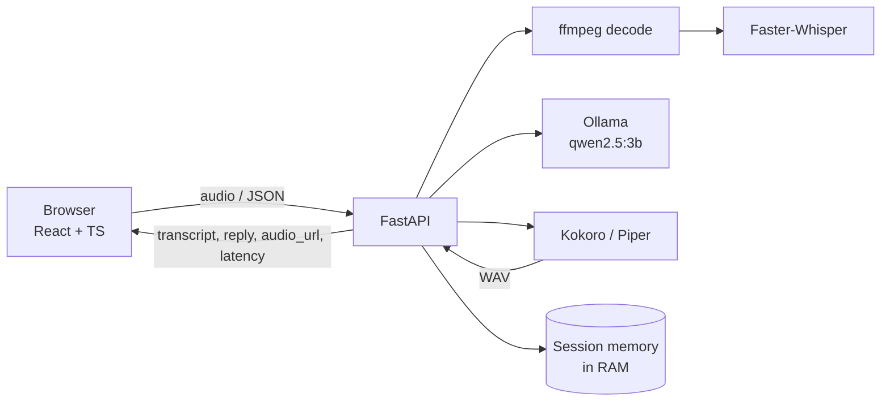

<<<<<<< HEAD
# VoxPilot - Optimized Local Voice AI Assistant

A browser voice assistant that runs entirely on your own machine with open-weight models. Speak (or type) in English or Hindi; VoxPilot transcribes with **Faster-Whisper**, answers with a quantized **Qwen** model served by **Ollama**, speaks the reply with **Kokoro** (Piper supported), and remembers the conversation. No paid or hosted AI API is used anywhere in the core pipeline.

Built for the Trikon Software Labs LLP AI internship assignment.

## Honest status

| Verified in the build environment | Needs verification on your machine |
|---|---|
| 47 backend tests passed (2 real-model tests skipped); frontend type-check, production build and 9 unit tests pass; the real FastAPI server starts, reports model status, and returns clear errors when models are missing; ffmpeg decoding of WAV, WebM/Opus, Ogg/Opus, MP4/AAC and MP3 | Real Faster-Whisper, Ollama, Kokoro/Piper inference; Hindi quality; browser microphone capture; CUDA; **all latency numbers** (none are recorded - see `docs/performance.md`) |

The sandbox had no GPU, no access to model hosts and no browser, so those parts are implemented and unit-tested against fakes but not run end to end. Section 7 gives the exact commands to verify them.

## 1. Features

- Browser microphone recording (MediaRecorder) with live level ring and optional stop-on-silence
- Faster-Whisper transcription (English/Hindi), server-side Silero VAD filter
- Local LLM via Ollama with a short, speech-friendly system prompt
- Kokoro TTS (English + Hindi voices); Piper as an alternative engine
- Per-session conversation memory (bounded), New conversation button
- Stop-speaking, interruption, stale-reply protection, duplicate-submit prevention
- Text input for debugging/accessibility; English/Hindi switch
- Live model health and measured per-stage latency
- Typed, user-safe errors; no fake answers on failure; size/type validation; temp-file cleanup; concurrency limits

## 2. Architecture



Details, a sequence diagram and design decisions: [`docs/architecture.md`](docs/architecture.md).

## 3. Models and why

| Role | Default | Why |
|---|---|---|
| STT | Faster-Whisper `small`, CPU `int8` | CTranslate2 is fast on CPU; `small` is the smallest size with usable Hindi. Runs on CPU so the 4 GB GPU stays free for the LLM |
| LLM | Ollama `qwen2.5:3b` (4-bit) | Fits a 4 GB GPU with a 2048-token context; multilingual. Weights are roughly 2 GB - confirm with `nvidia-smi` |
| TTS | Kokoro (82M) on CPU | Small, natural, English and Hindi voices, no GPU needed |

Hindi note: Qwen2.5-3B is noticeably weaker in Hindi than in English. For better Hindi, try a larger model your hardware can hold, or change `LLM_MODEL`.

Trade-offs you can change in `backend/.env` (see `.env.example`): `WHISPER_MODEL` (`base` is faster, `small`/`medium` more accurate), `WHISPER_BEAM_SIZE`, `LLM_MODEL`, `LLM_NUM_CTX`, `LLM_MAX_TOKENS`, `TTS_ENGINE`, `MAX_HISTORY_TURNS`, `STAGE_CONCURRENCY`.

## 4. Hardware

- Development target: Windows, NVIDIA RTX 3050 4 GB, CPU-compatible
- Minimum (CPU only): 4+ cores, 8 GB RAM (16 GB comfortable), ~6 GB disk for models
- GPU is used by Ollama automatically when available. Whisper and Kokoro default to CPU so all three models never compete for VRAM. To move Whisper to the GPU see "CUDA for Whisper" below
- Other systems: lower-end -> `WHISPER_MODEL=base`, `LLM_MODEL=qwen2.5:1.5b`; stronger GPU -> `WHISPER_DEVICE=cuda`, `WHISPER_COMPUTE_TYPE=float16`, `LLM_MODEL=qwen2.5:7b`

## 5. Setup (Windows PowerShell)

Prerequisites: Python 3.10-3.12, Node.js 20+, [Ollama](https://ollama.com/download). ffmpeg is bundled through the `imageio-ffmpeg` package, so no separate install is needed (set `FFMPEG_PATH` to use your own).

```powershell
git clone <your-repo-url> voxpilot
cd voxpilot
.\scripts\setup.ps1          # venv, Python deps, npm install, copies .env, pulls qwen2.5:3b
```

If script execution is blocked: `Set-ExecutionPolicy -Scope Process Bypass`.

Manual equivalent:

```powershell
cd backend
python -m venv .venv
.\.venv\Scripts\python.exe -m pip install -r requirements-dev.txt
Copy-Item ..\.env.example .env
cd ..\frontend; npm install
ollama pull qwen2.5:3b
```

### Text-to-speech setup (Kokoro) - not tested in the build sandbox

```powershell
cd backend
.\.venv\Scripts\python.exe -m pip install torch --index-url https://download.pytorch.org/whl/cpu
.\.venv\Scripts\python.exe -m pip install -r requirements-tts.txt
```

Hindi (and some English words) need **espeak-ng** installed on Windows (installer from the espeak-ng GitHub releases) and available on PATH. Kokoro Hindi voices: `hf_alpha`, `hf_beta` (female), `hm_omega`, `hm_psi` (male).

**Piper alternative:** download a Piper binary and `.onnx` voices, then set `TTS_ENGINE=piper`, `PIPER_EXECUTABLE`, `PIPER_MODEL_EN`, `PIPER_MODEL_HI` in `backend/.env`. The Piper path uses the `--model` / `--output_file` CLI flags and is untested here; Kokoro is the default.

### Download the speech models once

```powershell
cd backend
.\.venv\Scripts\python.exe ..\scripts\download_models.py
```

### CUDA for Whisper (optional)

CTranslate2 needs cuBLAS 12 and cuDNN 9 on the DLL path. If you have them (see the faster-whisper README for Windows options), set `WHISPER_DEVICE=cuda` and `WHISPER_COMPUTE_TYPE=int8_float16`. Check VRAM with `nvidia-smi` while a turn runs; if the LLM spills to CPU, go back to `cpu`.

## 6. Run

Terminal 1: `ollama serve` (the Ollama app usually already runs it)

```powershell
.\scripts\run-backend.ps1      # http://127.0.0.1:8000  (docs at /docs)
.\scripts\run-frontend.ps1     # http://localhost:5173
```

Open http://localhost:5173 in Chrome/Edge/Firefox/Safari and allow the microphone. The Models panel should show every service ready. Browsers allow microphone access on `localhost` over plain HTTP; other hostnames need HTTPS.

Linux/macOS: use the same commands with `source .venv/bin/activate`, `python -m uvicorn app.main:app` and `npm run dev`. A `docker-compose.yml` is intentionally not included: GPU passthrough plus Ollama and model caches could not be tested here.

### API examples

```powershell
curl http://127.0.0.1:8000/api/health
curl http://127.0.0.1:8000/api/models/status
curl -X POST http://127.0.0.1:8000/api/chat -H "Content-Type: application/json" -d '{\"message\":\"My name is Rahul\",\"language\":\"en\",\"speak\":false}'
curl -X POST http://127.0.0.1:8000/api/voice/respond -F "audio=@sample_en.wav;type=audio/wav" -F language=en
curl -X DELETE http://127.0.0.1:8000/api/sessions/<session_id>
```

Responses include `latency` with `audio_prep_ms`, `stt_ms`, `llm_ttft_ms`, `llm_ms`, `tts_ms`, `total_ms`, `time_to_audio_ms`. Errors: `{"error": {"code": "...", "message": "..."}}`.

## 7. Testing

```powershell
cd backend
.\.venv\Scripts\python.exe -m pytest -q                 # mocked unit/integration tests
$env:RUN_REAL_MODELS="1"; .\.venv\Scripts\python.exe -m pytest -m real -v -s   # real Whisper + Ollama + Kokoro
cd ..\frontend
npm test; npm run build                                  # unit tests, type-check, production build
```

Build-sandbox results: backend `47 passed, 2 skipped` (the 2 are the real-model tests); frontend `9 passed`, `tsc` clean, `vite build` OK. The real-model test synthesises speech with Kokoro, transcribes it with Whisper, asks Ollama, and checks that the model remembers "Rahul" and answers in Devanagari for Hindi. **Run it yourself and keep the output for your reviewer.**

Covered by automated tests: health/status, empty/oversize/unsupported/garbage/silent/too-short audio, real container decoding (WebM, Ogg, MP4, MP3, WAV), temp-file cleanup, session memory, bounded history, session isolation, reset, failed turns not remembered, STT/LLM/TTS failure paths, Ollama parsing (streaming, 404, down, timeout, error lines), full pipeline orchestration, WAV response format, disconnected-client skipping, same-session serialisation, no stack traces in responses. Frontend: audio helpers, error mapping, formatting. Not covered: browser recording UI (needs a real browser + microphone).

## 8. Performance measurement

See [`docs/performance.md`](docs/performance.md). In short:

```powershell
cd backend
.\.venv\Scripts\python.exe ..\scripts\make_sample_audio.py --out sample_en.wav
.\.venv\Scripts\python.exe ..\scripts\benchmark.py --audio sample_en.wav --runs 8 --label baseline --out ..\docs\benchmark-baseline.json
```

Cold (first request after a restart with `WARMUP_ON_START=false`) and warm runs are reported separately. The repository ships **no benchmark numbers** because none were measured.

## 9. Troubleshooting

| Symptom | Fix |
|---|---|
| Models panel: Language model red | Start Ollama (`ollama serve`) and `ollama pull qwen2.5:3b` |
| Text-to-speech red / `MODEL_UNAVAILABLE` Kokoro | Install `requirements-tts.txt` (and torch); Hindi needs espeak-ng |
| First reply takes very long | Whisper/Kokoro are downloading or loading. Run `download_models.py`, keep `WARMUP_ON_START=true` |
| `No speech was recognised` | Speak closer, check the mic input device; recordings under 0.3 s or silent are rejected |
| Microphone blocked | Allow it in the browser address bar; use `localhost` or HTTPS |
| Autoplay blocked | Press **Play reply** on the message |
| CUDA errors loading Whisper | Set `WHISPER_DEVICE=cpu`, or install cuBLAS 12 / cuDNN 9 |
| LLM out-of-memory | Lower `LLM_NUM_CTX`, use `qwen2.5:1.5b`, or close GPU apps |
| `503 BUSY` | Another turn is using the model; wait or raise `STAGE_CONCURRENCY` (needs more memory) |
| Frontend cannot reach backend | Backend on port 8000? Otherwise set `VITE_BACKEND_URL` (dev) or `VITE_API_BASE` (build) |

## 10. Privacy and licensing

- Audio, transcripts and replies stay on your machine; the only network traffic is the one-time model download (Hugging Face, Ollama registry). Recordings are never written to disk permanently; session memory lives in RAM and is lost on restart; replies are kept in a 20-item in-memory store.
- Check each model's licence before redistributing or commercial use: Faster-Whisper and OpenAI Whisper weights (MIT), Kokoro (Apache-2.0 weights), Piper and each Piper voice (see their repositories), and **Qwen2.5-3B, which is released under a Qwen research licence rather than Apache-2.0** (the 1.5B and 7B variants are Apache-2.0). Licence terms change; verify on the model pages.

## 11. Known limitations and future work

- Not run end to end on real models in the build sandbox (see "Honest status"); no recorded benchmark
- Reply is generated, then synthesised as one clip: no token streaming to the browser and no incremental TTS, so latency is the sum of the stages. Next step: stream Ollama tokens over SSE and synthesise sentence by sentence
- Server-side cancellation cannot stop a Whisper/Kokoro call already running in its thread
- If TTS fails after the LLM succeeded, the turn is stored in memory but the request returns an error
- Memory is in-process only; use Redis/SQLite for persistence. No authentication; intended for local use
- Qwen2.5-3B Hindi quality is limited
- Browser VAD is a simple RMS threshold; Safari (MP4/AAC) and Hindi accuracy are untested

## 12. Assignment checklist

| Requirement | Status |
|---|---|
| Browser microphone input | Implemented (`useRecorder`); needs your browser check |
| Faster-Whisper STT | Implemented; real run pending |
| Local Ollama LLM | Implemented; parsing tested against a mock server; real run pending |
| Local TTS (Kokoro/Piper) | Implemented; real run pending |
| Browser playback + stop | Implemented |
| Multi-turn memory, new conversation | Implemented and tested (mock LLM sees prior turns) |
| Hindi + English | Implemented end to end; quality unverified |
| Real latency display | Implemented (server-measured per stage + browser) |
| No paid hosted inference | Yes |
| Session isolation, error handling | Implemented and tested |
| Automated tests | 47 backend + 9 frontend passing; real-model suite provided |
| Architecture diagram | README + `docs/architecture.md` |
| Benchmark | Script + method + empty template; **numbers pending** |
| Demo script | `docs/demo-script.md` |

## Repository layout

```
voxpilot/
  backend/app/        config, errors, schemas, api, pipeline, main
  backend/app/services/  audio, stt, llm, tts, conversation
  backend/tests/      pytest suite (mocks + opt-in real models)
  frontend/src/       App, components, hooks, api client, lib
  docs/               architecture.md, performance.md, demo-script.md
  scripts/            setup.ps1, run-*.ps1, download_models.py, make_sample_audio.py, benchmark.py
  .env.example  .gitignore  README.md
```
=======

>>>>>>> 52dbb00c1d49a18a841546f09c4533d57f57f7c3
