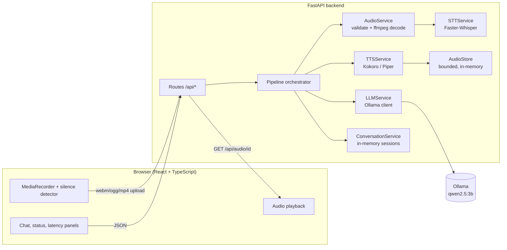
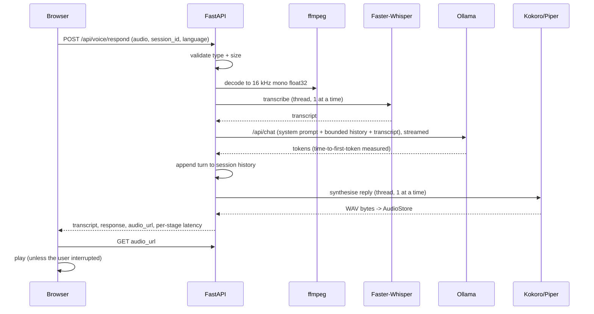

# VoxPilot architecture

## Components

## One voice turn

## Design decisions

- **Models load once.** Whisper and Kokoro are created lazily behind a lock and kept for the process lifetime. Optional background warm-up (`WARMUP_ON_START`) moves the load out of the first request. Ollama keeps its model resident for `LLM_KEEP_ALIVE`.
- **No event-loop blocking.** Whisper and Kokoro run in worker threads (`asyncio.to_thread`); Ollama and ffmpeg are awaited natively.
- **Bounded concurrency.** Each stage has a semaphore (`STAGE_CONCURRENCY`, default 1). Waiting longer than `QUEUE_TIMEOUT_S` returns `503 BUSY` instead of piling up work on a small GPU. Requests inside one session are serialised by a per-session lock so history stays ordered.
- **Honest failures.** Every model failure maps to a typed error (`MODEL_UNAVAILABLE`, `MODEL_TIMEOUT`, `MODEL_FAILURE`, `NO_SPEECH`, ...) with a user-safe message and a hint. Stack traces go to the log only. A failed LLM turn is never added to history, and no placeholder answer is ever returned.
- **Memory.** `ConversationService` keeps the last `MAX_HISTORY_TURNS` user/assistant pairs per session id, with TTL and capacity eviction. It lives in process memory and resets when the backend restarts. An unknown (but well-formed) session id starts a fresh session.
- **No temp-file leaks.** Uploaded audio is written to a temp file only for ffmpeg and deleted in a `finally`. TTS audio is held in a small in-memory LRU store, not on disk.
- **Interruption.** The browser aborts the in-flight request and pauses audio when the user records again, presses New conversation, or sends new input; a request counter ensures a late reply is dropped instead of played. On the server, a disconnected client is detected between stages so the LLM/TTS work is skipped. A stage that is already running (for example a Whisper call) cannot be cancelled mid-flight and finishes in its thread.
- **Browser VAD.** Auto-stop uses an `AnalyserNode` RMS threshold in the browser. Server-side, Faster-Whisper's built-in Silero VAD filter (`WHISPER_VAD_FILTER`) removes non-speech before decoding.
- **Not implemented (deliberately):** token-streaming to the browser and incremental TTS. The reply is synthesised as one clip, so `time_to_audio_ms` equals the server total. See "Future improvements" in the README.

## API summary

| Method | Path | Purpose |
|---|---|---|
| GET | `/api/health` | liveness + session count |
| GET | `/api/models/status` | readiness of STT, LLM, TTS, ffmpeg + active config |
| POST | `/api/voice/transcribe` | multipart `audio`, `language` -> transcript |
| POST | `/api/chat` | JSON `message`, `session_id`, `language`, `speak` -> reply (+ audio) |
| POST | `/api/voice/respond` | multipart `audio`, `session_id`, `language` -> full STT->LLM->TTS turn |
| DELETE | `/api/sessions/{id}` | forget a conversation |
| GET | `/api/audio/{id}` | fetch a synthesised reply (WAV) |

Errors always look like `{"error": {"code": "NO_SPEECH", "message": "..."}}`.
